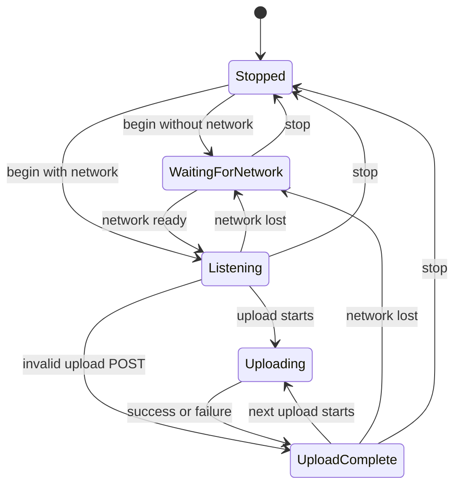

# HTTP state transitions

`state()` returns a `State` enum and `stateName(state)` supplies its diagnostic name.
All changes pass through `transitionTo()` and the existing status callback observes
the committed state. `running()` remains true in all three listener-active states.

Error is orthogonal to state: it records an operation failure independently of the current lifecycle.

| State | Meaning |
| --- | --- |
| `Stopped` | Explicitly disabled, including before begin |
| `WaitingForNetwork` | Enabled, but the readiness callback is missing or false |
| `Listening` | Accepting HTTP requests, with no upload result retained |
| `Uploading` | Processing a firmware upload, including pending final validation |
| `UploadComplete` | The last upload succeeded or failed, with the listener still active |

Successful completion is committed after final validation and the HTTP response,
before the success-only upload-complete callback. Stream failures complete immediately,
even when the final POST handler never arrives. `error()` distinguishes successful
and failed completion. Receiving the last file chunk alone does not complete an upload.

`UploadComplete` persists across ordinary requests, repeated begin calls, and ticks
until another upload starts or the listener stops/suspends. On network loss or stop,
an active upload is aborted and reports `UploadComplete` before the final
`WaitingForNetwork` or `Stopped` transition. The status callback can observe both
transitions synchronously; polling after tick sees the final state.

Listener start/stop actions occur only when crossing between listener-active and
inactive states. Upload transitions preserve the listener and registered routes.
Missing or cleared readiness suspends the service; explicit stop prevents automatic
restart until begin is called again. Repeated states do not repeat notifications.

`setStateChangeCallback()` registers an optional `void(State previous, State current)`
callback. It runs synchronously after state is committed and before transition
diagnostics, once per actual change. `nullptr` clears it. Keep callbacks brief and
do not re-enter the service. Diagnostic output is independent of this callback.

The `Uploading` callback runs before `Update.begin()` and any firmware write,
so applications can prepare for an upload. The HTTP request has already started;
this notification does not approve or reject it.
